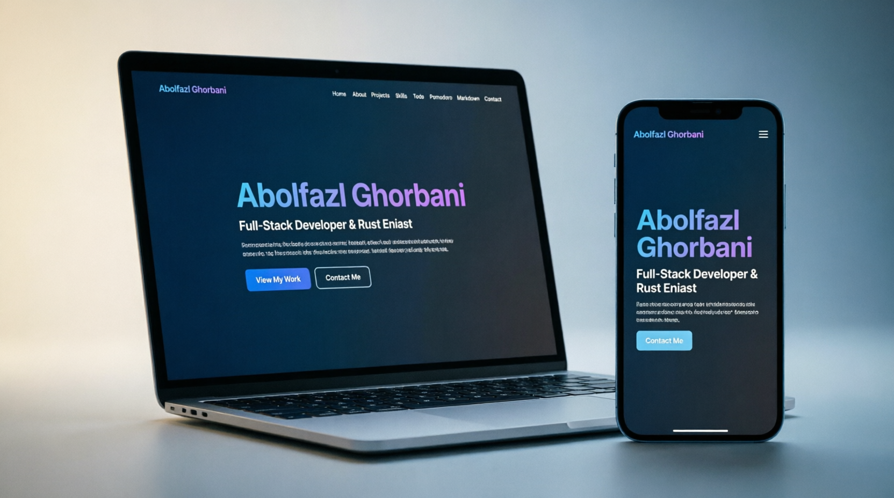

<div align="center">
  

  <h1>⚡ Rustam</h1>
  <p><b>A personal portfolio and mini-app playground written in Rust, compiled to WebAssembly with Dioxus.</b></p>

  <p>
    <a href="https://github.com/aghorbani84/rustam/actions/workflows/deploy.yml"></a>
    <a href="https://aghorbani84.github.io/rustam/"></a>
    
    
    
    <a href="LICENSE"></a>
  </p>

  <p><a href="https://aghorbani84.github.io/rustam/"><b>Live demo →</b></a></p>
</div>

---

## Overview

Rustam is a single-page web app built entirely in Rust with [Dioxus](https://dioxuslabs.com/) and compiled to WebAssembly. Alongside the usual portfolio pages, it ships three small productivity tools — a to-do list, a Pomodoro timer and a Markdown editor — that run fully in the browser (the to-do list and Pomodoro stats are saved to `localStorage`). It is deployed to GitHub Pages by a GitHub Actions workflow on every push to `main`.

## Features

- **Portfolio pages** — Home, About, Projects, Skills and Contact, with project cards, skill badges, a timeline and social links
- **To-do list** — add tasks with priorities, filter them, and keep them across reloads
- **Pomodoro timer** — configurable work / short break / long break lengths (25 / 5 / 15 min by default) with session stats
- **Markdown editor** — toolbar, live preview (rendered with `pulldown-cmark`), and export as `.md` or `.html`
- **Theming** — light / dark / system theme
- **Client-side routing** with the Dioxus router and an SPA fallback for GitHub Pages
- **Responsive layout** with a mobile menu

## Tech Stack

| Area | Technology |
| --- | --- |
| Language | Rust (edition 2024) |
| UI framework | Dioxus 0.7 (web + router) |
| Target | WebAssembly (`wasm32-unknown-unknown`) |
| Browser APIs | `web-sys`, `js-sys`, `wasm-bindgen`, `gloo-timers` |
| Markdown | `pulldown-cmark` |
| Styling | Tailwind CSS (CDN) + custom CSS |
| Deployment | GitHub Actions → GitHub Pages |

## Getting Started

### Prerequisites

- [Rust](https://www.rust-lang.org/tools/install) (stable, with edition 2024 support)
- The WebAssembly target and the Dioxus CLI:

```bash
rustup target add wasm32-unknown-unknown
cargo install dioxus-cli --locked
```

### Run locally

```bash
git clone https://github.com/aghorbani84/rustam.git
cd rustam
dx serve
```

Open the local URL printed by `dx serve`. The app is configured with the base path `/rustam` (see `Dioxus.toml`), matching its GitHub Pages address.

### Production build

```bash
dx build --release
```

## Project Structure

```text
rustam/
├── src/
│   ├── main.rs, app.rs      # Entry point, router and layout
│   ├── pages/               # Home, About, Projects, Skills, Contact, Todo, Pomodoro, Markdown…
│   ├── components/          # UI components (cards, timeline, todo/, pomodoro/, markdown/)
│   ├── hooks/               # use_local_storage, use_theme, use_interval, use_markdown
│   ├── models/              # Todo, Pomodoro and Markdown data types
│   └── styles/              # App CSS
├── assets/                  # Preview images
├── index.html, manifest.json, robots.txt, sitemap.xml
├── Dioxus.toml
└── .github/workflows/deploy.yml
```

## License

Licensed under [Creative Commons Attribution-NonCommercial-NoDerivatives 4.0](LICENSE) (CC BY-NC-ND 4.0). You may share it with attribution for non-commercial purposes, but not distribute modified versions. See [LICENSE](LICENSE) for details.

## Author

Built by [@aghorbani84](https://github.com/aghorbani84).
